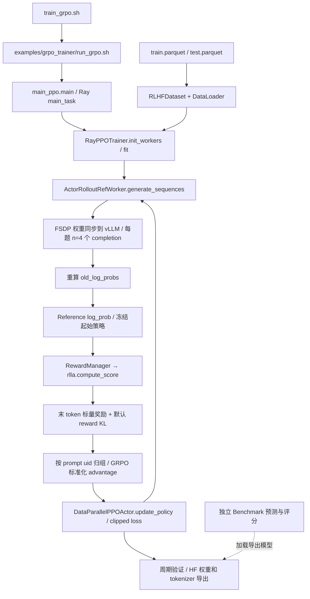

# Phase 1：仓库与训练架构审计

审计日期：2026-10-18（Asia/Shanghai）。代码基线：`8cee13ec0ca72f0461da372a93a6fd8140dbb840`。
本报告中的“已验证”限于本地文件、静态调用关系、数据统计和 CPU 小样例；不代表 GPU 运行通过。

## 1. 初始 Git 状态

| 项目 | 已验证结果 |
| --- | --- |
| 路径 | `/Users/tan/Projects/ToolRL`，沿用现有仓库 |
| 分支 | `feature/phase1-audit`；`main` 保留在基线提交 |
| 工作区 | 初始 `git status --short --branch` 只有分支名，无改动 |
| origin | `https://github.com/tanjinghai/ToolRL.git` |
| upstream | `https://github.com/qiancheng0/ToolRL.git` |
| 初始 SHA | `8cee13ec0ca72f0461da372a93a6fd8140dbb840` |

仓库内未发现 `AGENTS.md`。未 fetch/merge 上游、未重新 clone/init、未修改核心训练代码、未下载模型、未申请 GPU。初始系统 Python 没有 torch/vLLM/datasets；这不能证明其他 Python 环境或外部 AutoDL 账户的状态。项目目录中没有新增训练产物。

## 2. 项目究竟训练什么

**已验证：这是对工具选择和参数生成做规则奖励后训练的单次 completion GRPO，可包含静态多轮对话上下文；不是在训练中与真实工具环境持续交互的多轮 Agent RL。**

证据链：`dataset/rlla_4k_raw/rlla.py::process_fn` 把已有历史装进一个 user 消息；`RLHFDataset.__getitem__` 模板化；`RayPPOTrainer.fit` 每个 batch 调用一次 `generate_sequences`，随后直接计算与 ground truth 的匹配奖励。`vLLMRollout.generate_sequences` 仅调用推理引擎，`rlla.py` 仅解析 JSON 和比较标签。该路径不存在工具 registry、executor、`env.step(action)` 或将新执行结果追加到训练 trajectory 的循环。

输入里有 `<obs>`、输出里有多个 tool call，都不证明发生了在线环境交互。`benchmarks/Bamboogle/generate.py` 的搜索→observation→再次生成是真实多轮**评测**，不在上述训练调用链内。

[论文 v1 §3.1–3.4](https://arxiv.org/html/2504.13958v1) 描述 TIR 及执行反馈；本审计以公开代码为边界，不将论文描述视为已实现功能。论文关于 cold-start 优势是其设置下的结果，不能预设本项目 E2/E3 的优劣。

## 3. 核心调用图

## 4. 核心文件与行为

| 代码位置 / 符号 | 已验证作用 |
| --- | --- |
| `train_grpo.sh`、`examples/grpo_trainer/run_grpo.sh` | 覆盖 Hydra 配置，GRPO / FSDP / vLLM；两卡、512 prompt/batch、n=4、15 epochs 是原始设置，不是低成本推荐 |
| `verl/trainer/main_ppo.py::main_task` | Ray 资源池、tokenizer、角色绑定、RewardManager、启动 trainer；PPO 共用此入口 |
| `verl/utils/dataset/rl_dataset.py::RLHFDataset` | Parquet 读取，system/user chat template，左侧 padding/truncation |
| `verl/trainer/ppo/ray_trainer.py::init_workers` | ActorRollout、Reference 角色共置；GRPO 不创建 critic；GAE/PPO 创建 critic |
| `verl/workers/fsdp_workers.py::ActorRolloutRefWorker` | HF 模型、FSDP、AdamW、rollout、old/ref log-prob、actor 更新、导出 |
| `verl/workers/sharding_manager/fsdp_vllm.py` | FSDP state dict 与 vLLM 权重同步、内存/随机状态切换 |
| `verl/workers/rollout/vllm_rollout/vllm_rollout.py` | prompt token IDs → vLLM generate，展开 n 个回答，EOS mask；无工具执行 |
| `verl/trainer/main_ppo.py::RewardManager.__call__` | 解码 prompt+response；分派 rlla reward，把总分和各分量写到回答末 token |
| `verl/utils/reward_score/rlla.py` | format、tool correctness、可选 length；[详见奖励审计](reward_analysis.md) |
| `verl/trainer/ppo/core_algos.py::compute_grpo_outcome_advantage` | 按 uid 求组均值、标准差；序列分数标准化后广播给有效回答 tokens |
| `verl/workers/actor/dp_actor.py::update_policy` | token log-prob ratio、clip=0.2、mask mean、entropy bonus、反传/梯度裁剪/AdamW |
| `ray_trainer.py::_validate / _save_checkpoint` | 原验证只汇总 reward；周期导出 actor HF 模型和 tokenizer，无独立 benchmark |
| `verl/trainer/fsdp_sft_trainer.py` | 通用全参 SFT 入口，存在数据适配问题；[详见 SFT 方案](sft_plan.md) |
| `verl/third_party/vllm/` | 内置适配 0.3.1/0.4.2/0.5.4/0.6.3 私有接口，不可只升级 pip 中的 vLLM |
| `verl/single_controller/`、`verl/protocol.py` | Ray worker RPC/资源管理、DataProto tensor 与非 tensor 数据搬运 |
| `verl/models/`、`verl/utils/` | 模型兼容、移除 padding、分布式、tokenization、日志等基础设施 |

Reference 从实验起始模型加载并保持冻结，用来限制策略漂移；E3 默认 reference 是 SFT 模型，而非最初 E0 模型，必须记录。它不是 reward model，也不是 GRPO critic。

## 5. 完整性判断与启动前风险

**GRPO 算法链路在源码中闭合，但不能认定原脚本当前环境可直接训练，更不能认定整个实验工程完整。**

- 已有：rollout、old/reference 概率、规则 reward、group advantage、clipped policy update、周期验证、HF 权重保存、PPO 对照入口。
- 缺少：统一独立评测、数据版本/污染审计、SFT 适配、预算计量、可靠断点续训、实际训练工具环境。
- 论文 §3.4 声称不使用 reference KL；代码默认 `use_kl_loss=False` 仍走 `apply_kl_penalty`，`algorithm.kl_ctrl.kl_coef=0.001` 生效。忠实论文实验应明确设为 0；保留代码默认时须标记区别，先验证数值再调整。
- 论文组标准差公式为总体标准差；源码 `torch.std` 未指定 correction，使用 PyTorch 默认样本标准差。另有 entropy bonus 默认 0.001。这些属于需要冻结的算法细节。
- `RLHFDataset` 的长 prompt 过滤代码被注释，传入 `filter_prompts=True` 没有实际过滤；左截断可丢工具定义。禁用 chat template 的备用分支遍历空字符串，也不可当可用路径。
- validation loader 实际 `batch_size=len(val_dataset)`，`data.val_batch_size=128` 不起分批作用。原 test 同时每 5 step 验证，不能当未见测试集。
- `fit` 从 step=1 开始，更新后递增并以 `>= total_training_steps` 退出，正常多步配置存在少执行最后一步的边界。退出时只验证，未强制保存最终 checkpoint；若总步数小于 save_freq，可能一个 checkpoint 也没有。
- `save_checkpoint` 只保存 HF 权重/tokenizer，无 optimizer、scheduler、RNG、数据游标恢复。重新加载模型继续训练不等于精确 resume。
- actor 的可选显式 KL loss 分支使用 `policy_loss - kl_loss*coef`，最小化时方向值得专项核验；默认关闭该分支，不在本轮修复。
- `RewardManager` 已被定制成四元组返回契约，其他继承的 math reward / learned RM 不能未经检查就认为仍兼容。

## 6. Git 与敏感文件

原 `.gitignore` 未覆盖 `.safetensors`、`.bin`、`.env.*` 等，本轮补充模型、凭据和本地结果目录规则，保留已经版本管理的小型数据。
原 `benchmarks/Bamboogle/secret.json` 已被跟踪，三个值经本地检查为占位内容；仅加 ignore 无法保护已跟踪文件。现移为 `secret.example.json`，实际运行时复制为被忽略的 `secret.json`，不改 benchmark 读取逻辑。不重写历史，不输出任何凭据。
`LICENSE` 和原 README 介绍保留。ignore 不是安全扫描器；每次提交仍应检查 staged diff/大文件。

最终验证及交付清单见 [阶段报告](README.md)，下一阶段见 [实验计划](experiment_plan.md)。
