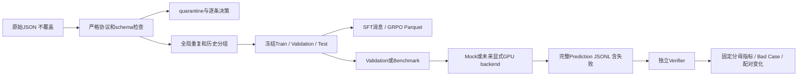

# ToolRL Phase 2：数据构建与统一评测

日期：2026-10-18。从`feature/phase1-audit@c6aec5f`创建`feature/phase2-data-eval`，未从main起步、未合并PR #1。Phase2只做GPU前数据/评测准备；未租GPU、下载完整模型、运行真实推理/SFT/GRPO或调用搜索/付费judge。

核心代码提交：`dd60a7c`、`702b60d`；最后的数据/证据/文档提交与推送/Draft PR结果在交付消息中提供，避免提交自身SHA循环引用。

## 已交付

| 产物 | 位置 |
| --- | --- |
| 清洗后数据、quarantine、完整lineage、Parquet | 本地`dataset/generated/phase2-v1/`（约42MB，Git忽略，可确定性重建） |
| 冻结版本/9份manifest/最终Test hash | [`data_manifests/phase2-v1`](../../data_manifests/phase2-v1/version.json)及[FROZEN](../../data_manifests/phase2-v1/FROZEN.json) |
| 清洗规则、规模和分布 | [数据质量报告](data_quality.md)、[逐条RL决策](evidence/decisions/rl.jsonl)、[逐条SFT决策](evidence/decisions/sft.jsonl) |
| 数据构建/SFT/GRPO转换、训练子集接口 | `toolrl_pipeline/data.py`、`grouping.py`、`schema.py`、`tokenization.py` |
| 独立Verifier、统一生成/评分/Bad Case | `protocol.py`、`verifier.py`、`evaluation.py`、`cli.py`；[操作与口径](evaluation_guide.md) |
| API-Bank严格/历史分数、BFCL快照/桥接 | [Benchmark适配](benchmark_adapters.md)、`configs/bfcl_snapshot.json` |
| CPU单元测试/真实tokenizer/Mock验收 | [validation.json](evidence/validation.json)、[测试日志](evidence/unittest.log)、[tokenizer检查](evidence/tokenizer_validation.json)、[Mock指标](evidence/mock_metrics.json) |
| 连续GPU阶段设计 | [gpu_continuous_execution_plan.md](../gpu_continuous_execution_plan.md) |



## 验收问题 A–K

**A. 数据泄漏解决了吗？** 已解决Phase1已知交集和本轮精确/词法/历史检测范围内的跨split泄漏：保留组和精确prompt交集均为0。SFT/RL的37个原始精确重叠中27个有效prompt保留在train，另10个SFT因独立质量问题隔离；没有一刀切删除重叠样本。API-Bank597、Bamboogle125、固定BFCL17文件的6842条user消息未命中训练关联组。语义改写、缺失源ID与预训练污染仍无法排除，不能宣称绝对无污染。

**B. 清洗后保留多少？** RL4000→3125（重复删除9、隔离866）；SFT400→319（隔离81）；合计保留3444、隔离947，没有猜测修改GT。原始JSON/旧Parquet/原Reward保持不变。所有4400次原始出现都有ID、原hash和决定理由，修复机制有合成测试，但真实数据确定修复数为0。

**C. 如何划分？** seed31415，先全局组隔离，再按来源/任务类型/组大小近似80/10/10；跨SFT/RL保留组锚定train。RL为2511/307/307；SFT为245/37/37。公共Validation和final Test各344，所有E0–E4共用同一Test；旧test80只保留历史兼容。Test已用FROZEN和hash锁定，生成/评分需显式解锁，训练子集接口拒绝held-out ID。

**D. SFT/RL格式？** SFT保留system/user和完整assistant目标（含原think），提供JSONL和消息prompt/response Parquet；真实Qwen模板只应用一次，prompt labels=-100，assistant和一个EOS监督。GRPO提供原veRL可读取的prompt/reward_model/style/ground_truth等Parquet，工具清单完整、GT不进入生成请求。旧SFT Trainer仍需Phase3 adapter，不能把数据构建通过当训练可运行。

**E. Verifier能处理异常吗？** 35项CPU测试包含坏JSON/重复key、缺/多参数、bool/int、数字字符串、嵌套类型、同名/重复/额外调用、parallel重排、sequential次序、no-tool、截断和invalid GT。Verifier不调用训练Reward，所有坏行都计为失败，不静默修复。自由文本语义和任务执行成功率保持null。

**F. Benchmark统一入口？** API-Bank597题已接统一prediction/strict verifier/legacy soft-match；路径独立于cwd，失败固定分母。发现118题GT与schema冲突或不可验证：保留主表597分母并另报479题有效GT子集。BFCL固定快照、污染检查、严格decode桥接及签名检查已CPU验证，官方环境与官方分数未跑。Bamboogle仅保留后续计划，未调用服务。

**G. 自动Bad Case能输出什么？** 多标签错误计数/比例、任务类型/调用数/参数数/benchmark level切片、典型失败、人工核验清单；比较上一实验时输出修复/退化ID、错误类别数量差和指标差。读取已保存prediction即可，无需加载模型，也不自动授权追加实验。

**H. 哪些CPU实测？** 195个Python文件AST、4个shell语法；35项单元测试全部通过且0跳过；两次构建hash一致、原数据未动、全部保留样本schema通过、组/精确prompt跨split交集0；282条真实Qwen SFT train/validation检查通过，tokenizer/config共7,039,610字节且已校验官方Git blob。344题Validation和597题API-Bank Mock全链路通过。oracle mock为344/344，mixed故意注错并触发错误分类/对照变化；**这些不是模型评测成绩**。

**I. 哪些仍需GPU？** torch/CUDA/FlashAttention/vLLM/Ray/FSDP兼容、实际模型推理质量/显存/吞吐、训练前后权重变化、数值稳定性、optimizer恢复、真正BFCL执行与费用。Mac CPU环境没有torch/vLLM。tokenizer读取不是模型推理，mock通过不代表Baseline通过。

**J. Phase3实现什么？** messages SFT adapter/Trainer、GRPO显存与长度预检、Reward安全校验和独立变体、最终checkpoint与完整resume、AutoDL锁环境/部署、带授权/费用/超时闸门的实验DAG和备份停机流程。已知长度风险：RL train14条prompt>2048、1条>4096，SFT train10条总长>2048；禁止靠左截断工具定义蒙混通过。原Reward关键类型/匹配问题须先解决可验证性闸门。

**K. 如何连续使用GPU？** 按[连续执行计划](../gpu_continuous_execution_plan.md)，租前完成Phase3工程/CPU dry-run，模型与环境只准备一次；获批后同实例执行兼容/吞吐→E0→E1→验证/Bad Case→已授权E2/E3/E4→final Test→备份/核费/关机。预登记退化、零组内方差、Reward/Verifier冲突、NaN/OOM和费用停止条件；等待人工决策先保存/备份并关机，不长期占卡。总帽约500元须扣历史实际消费，本轮GPU/API消费为0；历史账户账单未知，不把剩余预算默认为500。

## 重建和复核

```bash
# 在独立CPU环境，不安装根目录CUDA训练依赖
python3 -m venv /tmp/toolrl-phase2-venv
/tmp/toolrl-phase2-venv/bin/python -m pip install -r scripts/phase2/requirements.txt

# allowlist小型资产；GitHub需gh只读连接，HF直连失败可显式选择镜像
python scripts/phase2/fetch_assets.py --bfcl
python scripts/phase2/fetch_assets.py --qwen-tokenizer --hf-endpoint https://hf-mirror.com

# 输出到新目录；已冻结路径拒绝覆盖
/tmp/toolrl-phase2-venv/bin/python -m toolrl_pipeline build-data \
  --output /tmp/toolrl-phase2-rebuild --manifests /tmp/toolrl-phase2-rebuild-manifests \
  --bfcl-dir data_local/bfcl/a84eb805fe8d66635a8e402a78783f13044decba --freeze

/tmp/toolrl-phase2-venv/bin/python scripts/phase2/validate.py \
  --data-root dataset/generated/phase2-v1 --manifests data_manifests/phase2-v1 \
  --tokenizer data_local/tokenizers/Qwen2.5-1.5B-Instruct/989aa7980e4cf806f80c7fef2b1adb7bc71aa306 \
  --work-dir runs/new-cpu-validation --output-dir /tmp/toolrl-phase2-verification
```

跨机器精确重建应匹配记录的Python/Unicode处理行为和pyarrow版本，CPU依赖与实际freeze已保存；数据版本绑定输入/转换代码，**文件hash才是生成物验收依据，不能只看版本字符串**。优先把已冻结产物复制到GPU并核hash；若重建结果不同应停止排查，不能覆盖旧manifest或退回旧test80。

本轮修改范围：新增toolrl_pipeline、CPU工具/测试/configs、小manifest/逐条决策/中文报告；API-Bank两脚本改统一薄入口；README追加Phase2入口。没有改veRL主干或原Reward，没有进入Phase3。
